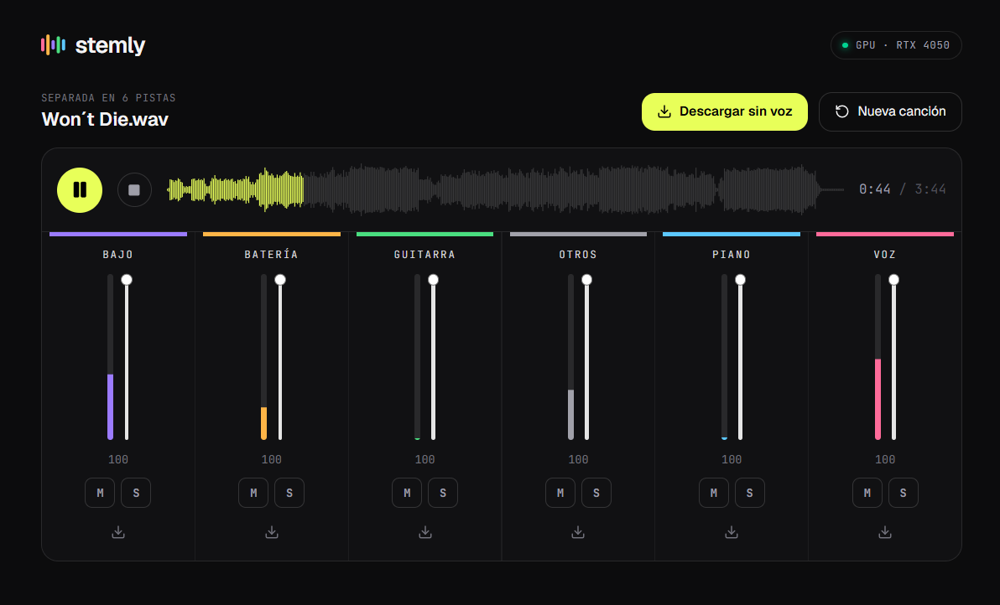

<div align="center">

# stemly

**Desarmá cualquier canción en sus pistas: voz, batería, bajo, guitarra y piano.**
Todo se procesa en tu computadora. Tu música nunca sale de ella.



</div>

---

## ¿Qué hace?

Stemly usa inteligencia artificial ([Demucs](https://github.com/facebookresearch/demucs), de Meta) para separar una canción en pistas independientes, y te deja mezclarlas en vivo antes de descargarlas.

- 🎤 **Modo karaoke**: descargá la canción completa sin la voz con un clic
- 🎚️ **Mezclador en vivo**: subí, bajá, silenciá (M) o aislá (S) cada instrumento mientras suena
- 💾 **Exportá tu mezcla**: por ejemplo, la canción sin guitarra, en un solo archivo
- 🎵 **WAV, FLAC o MP3**: elegí el formato de todas tus descargas
- 📊 **Medidores de nivel y forma de onda**: clic en la onda para saltar a cualquier parte
- 🎸 **Dos modelos**: 6 pistas (voz, batería, bajo, guitarra, piano, otros) o 4 pistas (más preciso)
- ⚡ **Acelerado por GPU**: una canción de 3 minutos se separa en ~10 segundos con una NVIDIA (también funciona en CPU, más lento)
- 🧹 **No llena tu disco**: las pistas que ya no usás se borran solas
- 🔒 **100% local**: sin cuentas, sin subir nada a internet

## Casos de uso

- Practicar tu instrumento sobre la canción original, sin tu parte
- Hacer karaoke o covers
- Sacar acapellas para remixes
- Estudiar cómo está arreglada una canción escuchando cada instrumento por separado

## Requisitos

| | Mínimo | Recomendado |
|---|---|---|
| Sistema | Windows 10/11 | Windows 11 |
| Python | 3.11 | 3.11 |
| Node.js | 20 | 20 o superior |
| FFmpeg | Sí | Sí |
| GPU | No (usa CPU) | NVIDIA con 4 GB de VRAM o más |

## Instalación

### 1. Clonar el repositorio

```powershell
git clone https://github.com/Tigresitop/Stemly.git
cd Stemly
```

### 2. Instalar FFmpeg y Python 3.11

```powershell
winget install Gyan.FFmpeg
py install 3.11
```

### 3. Backend (motor de separación)

```powershell
cd backend
py -3.11 -m venv .venv
.\.venv\Scripts\Activate.ps1
```

Instalá PyTorch según tu equipo:

```powershell
# Con GPU NVIDIA
pip install torch==2.5.1 torchaudio==2.5.1 --index-url https://download.pytorch.org/whl/cu121

# Solo CPU
pip install torch==2.5.1 torchaudio==2.5.1 --index-url https://download.pytorch.org/whl/cpu
```

Y el resto de dependencias:

```powershell
pip install -r requirements.txt
```

### 4. Frontend (interfaz)

```powershell
cd ..\frontend
npm install
```

## Uso

Abrí **dos terminales**:

```powershell
# Terminal 1: backend
cd backend
.\.venv\Scripts\Activate.ps1
python main.py
```

```powershell
# Terminal 2: frontend
cd frontend
npm run dev
```

Entrá a **http://localhost:3000**, soltá una canción y elegí el modelo.

> La primera separación descarga el modelo de IA (~80 MB). Después funciona sin internet.

> **Guardá lo que quieras conservar.** Las pistas viven temporalmente en `backend/data` y se borran al apretar *Nueva canción*, tras 30 minutos sin uso o al reiniciar el backend. Lo que ya descargaste a tu computadora no se toca.

## Cómo funciona

```
┌──────────────────┐   sube la canción    ┌──────────────────────┐
│  Interfaz        │ ───────────────────▶ │  Backend (FastAPI)   │
│  Next.js         │                      │  127.0.0.1:8000      │
│  localhost:3000  │ ◀─────────────────── │  + Demucs + PyTorch  │
└──────────────────┘   pistas en WAV      └──────────────────────┘
        │                                            │
   Web Audio API                                 GPU / CPU
   (mezcla en vivo)                           (separación con IA)
```

- El backend escucha **solo en `127.0.0.1`**: no es accesible desde tu red ni desde internet.
- La canción original se borra apenas termina la separación.
- La pista instrumental se genera sumando todas las pistas menos la voz.
- Las conversiones a MP3/FLAC y las mezclas exportadas las hace FFmpeg.

### API

| Método | Ruta | Descripción |
|---|---|---|
| `GET` | `/health` | Estado del servidor, GPU detectada y FFmpeg |
| `POST` | `/separate` | Sube una canción y arranca la separación |
| `GET` | `/status/{job_id}` | Progreso del trabajo |
| `GET` | `/stems/{job_id}/{stem}?format=wav\|mp3\|flac` | Descarga una pista |
| `POST` | `/mix/{job_id}` | Exporta una mezcla: `{"gains": {"vocals": 0.5, ...}, "format": "mp3"}` |
| `DELETE` | `/jobs/{job_id}` | Borra las pistas de un trabajo |

Documentación interactiva en **http://127.0.0.1:8000/docs** con el backend encendido.

## Stack

**Backend:** Python · FastAPI · Demucs · PyTorch · FFmpeg
**Frontend:** Next.js · TypeScript · Tailwind CSS · shadcn/ui · Web Audio API

## Hoja de ruta

- [x] Separación en 4 y 6 pistas
- [x] Pista instrumental (sin voz)
- [x] Mezclador en vivo con mute, solo y volumen
- [x] Exportar la mezcla personalizada en un solo archivo
- [x] Descargas en WAV, FLAC y MP3
- [x] Limpieza automática de pistas sin uso
- [ ] Aplicación de escritorio instalable (Tauri)

## Aviso

Usá Stemly con música que te pertenezca o que tengas permiso para usar. La separación de pistas no cambia los derechos de autor de la obra original.

## Créditos

- [Demucs](https://github.com/facebookresearch/demucs) de Meta AI Research (licencia MIT): el modelo que hace la separación.

## Licencia

[MIT](LICENSE) © 2026 John Ismael Tigre Cuji
